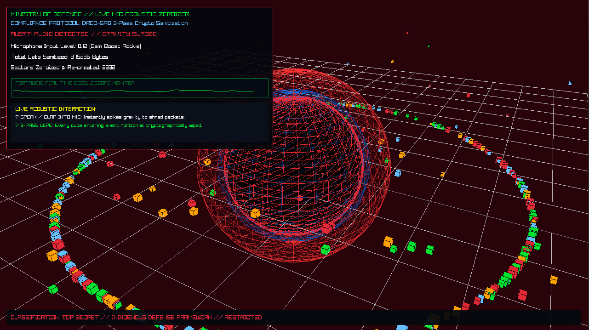

# Tactical C++ Zeroization Console
## The Core Problem & Philosophy

When a physical security breach happens, remote network commands and operating system file deletions are completely useless—adversaries sever network lines first. A true emergency fail-safe cannot rely on slow disk queues or high-level software APIs. It has to react instantly to physical room dynamics at hardware execution speeds.

This project bridges ambient room acoustics with low-level memory destruction. It captures live microphone input via a background thread, translating voice or claps into a real-time gravitational particle simulation rendered in 3D. At the center sits a black hole. When room noise spikes, the singularity’s gravity surges, swallowing orbiting data packets—and the moment a packet crosses the event horizon, the C++ engine executes an irreversible, military-grade memory wipe.

## The Physics & Vector Kinematics Engine

The simulation runs on a custom mathematical vector field calculated frame-by-frame in C++:
### 1. Dynamic Inverse-Square Gravity

```
float dynamicGravity = 8.0f + (smoothedAmplitude * 40.0f);
float radialAccel = dynamicGravity / (dist * dist + 0.01f);
```
    What it does & Why: This calculates how hard the black hole pulls on each packet based on distance. The 0.01f term prevents division errors at the center, while multiplying by microphone amplitude means a sudden shout or clap instantly supercharges the black hole’s gravitational pull.

### 2. Tangential Vortex Accretion Swirl

```
Vector3 tangent = { -normDir.z, 0.0f, normDir.x };
float vortexSwirl = 4.0f / (dist + 0.05f);
```
    What it does & Why: Instead of letting particles crash straight into the center, this shifts their momentum 90 degrees sideways. As they get closer to the event horizon, the divisor shrinks, forcing them to spin faster like real matter swirling into a black hole.

### 3. Velocity Integration & Air Damping

```
pkt.velocity = Vector3Add(Vector3Scale(normDir, radialAccel * dt), Vector3Scale(tangent, vortexSwirl * dt));
pkt.velocity = Vector3Scale(pkt.velocity, 0.94f);
```
    What it does & Why: Integrates acceleration over delta time while applying a 0.94f friction factor. This stops runaway momentum, locking particles into a smooth, stable orbital dance until audio energy disturbs them.

## Asynchronous Audio Pipeline (PortAudio)

```
static int PortAudioCallback(const void *inputBuffer, void *outputBuffer, unsigned long framesPerBuffer, ...) {
    const float *in = (const float*)inputBuffer;
    float peak = 0.0f;
    for (unsigned long i = 0; i < framesPerBuffer; i++) {
        float val = fabsf(in[i]);
        if (val > peak) peak = val;
    }
    g_micAmplitude = peak * MIC_GAIN;
    return paContinue;
}
```
    What it does & Why: Runs on a dedicated hardware thread managed by PortAudio, sampling room audio at 44.1 kHz without blocking the 60 FPS graphics loop. It isolates heavy audio parsing and exposes a thread-safe peak amplitude to the main rendering loop.

## The DRDO-SAG 3-Pass Cryptographic Wipe


```
void ExecuteDRDOSAGSanitization(TacticalPacket& pkt) {
    std::memset(pkt.secureBuffer, 0x00, sizeof(pkt.secureBuffer)); // Pass 1: Zero-fill
    std::memset(pkt.secureBuffer, 0xFF, sizeof(pkt.secureBuffer)); // Pass 2: Complement-fill
    for (size_t i = 0; i < sizeof(pkt.secureBuffer); ++i) pkt.secureBuffer[i] = rand() % 256; // Pass 3: Random
    pkt.isZeroized = true;
}
```

    What it does & Why: A standard delete or free() only unlinks pointers, leaving raw data sitting in RAM. The moment a packet drops below the 1.5f event horizon radius, this function fires an active 3-pass byte scrub (zeros, ones, and cryptographic noise) complying with defense standards, destroying electrical memory traces beyond forensic recovery.

## Technical Learning Objectives

    Real-Time DSP: Handling non-blocking hardware audio streams using PortAudio thread callbacks and shared volatile states.

    Physics Engine Architecture: Implementing customized inverse-square vector kinematics and vortex accretion math in C++ with Raylib.

    Low-Level Memory Manipulation: Working with raw C++ structs, byte arrays (uint8_t), heap allocations, std::memset, and multi-pass cryptographic buffer overrides.

## Presentation & Industry Evaluation

Designed, developed, and demonstrated live at the Annual CS Exhibition 2026. Evaluated and formally commended by visiting defense leadership and educational directors:

    Major General Dr. Abhay Dayal, AVSM, VSM (Retd.)

    Major General S. S. Nair, AVSM (Retd.)
